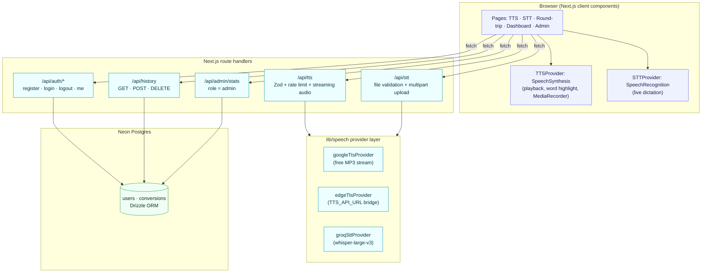

# VoiceBridge

**Design and Implementation of a Text-to-Speech / Audio System and Vice-Versa**

VoiceBridge is a production-quality web application that converts **text into natural-sounding
audio (TTS)** and **audio into text (STT)** — plus a round-trip mode that sends text → audio →
text and reports a **Word Error Rate (WER)** score so you can measure how accurately the message
survives the loop.

---

## Table of contents

1. [Features](#features)
2. [Tech stack](#tech-stack)
3. [Architecture](#architecture)
4. [Getting started](#getting-started)
5. [Environment variables](#environment-variables)
6. [Scripts](#scripts)
7. [How the speech engines work](#how-the-speech-engines-work)
8. [Deployment to Vercel](#deployment-to-vercel)
9. [Testing](#testing)
10. [Project structure](#project-structure)
11. [Assumptions & known limitations](#assumptions--known-limitations)
12. [Troubleshooting](#troubleshooting)

---

## Features

### Text → Speech (`/tts`)
- Large editor with a live character/word counter (5,000-character request limit)
- Upload a `.txt` file to fill the editor, or click **Try an example**
- Voice selector grouped by language/accent (English US/UK/NG and every voice the OS provides)
- Speed (0.5×–2×), pitch and volume controls
- Play / Pause / Resume / Stop with a progress bar and **live word/sentence highlighting**
- Two engines: **browser `SpeechSynthesis`** (free, zero-server) and **server MP3** (streaming)
- **Download MP3** from the server engine, or **Record & download** via `MediaRecorder` +
  tab-audio capture in browsers that support it (the button hides itself otherwise)
- Automatic fallback: if the server engine fails, the UI switches to the browser voice

### Speech → Text (`/stt`)
- **Live dictation**: microphone button, interim + final transcript, language selector,
  real-time waveform/level meter, auto-restart for long sessions
- **File transcription**: drag-and-drop `.mp3 .wav .m4a .webm .ogg` (max 25 MB) with upload
  progress, then an editable transcript with optional timestamps
- Export the transcript as **`.txt`**, **`.docx`** or **`.srt`**, plus copy-to-clipboard and clear
- Confidence indicator derived from the recognition engine
- Friendly browser-support banner and step-by-step microphone permission instructions

### Round-trip demo (`/roundtrip`)
- One click runs text → MP3 → Whisper → text
- Shows **original vs. transcribed** with a word-level diff (substitutions / deletions / insertions)
- Reports a **WER %** score with S/D/I breakdown and a downloadable report

### Accounts, history & admin
- Register / Login / Logout with **JWT in httpOnly cookies** and **bcrypt** (cost 12)
- Dashboard: every conversion (type, timestamp, preview, language, duration) with re-open,
  re-download and delete
- Usage cards: total conversions, total minutes of audio, most-used language
- Guests can use every tool — history is only stored for signed-in users
- Seeded **admin** role: `/admin` shows total users, total conversions, audio processed,
  most-used language and a recent-activity table (also exposed at `GET /api/admin/stats`)

### Quality of life
- Dark/light theme with no flash of wrong theme
- Mobile-first responsive layout, large tap targets, skip-to-content link
- Toasts, skeletons, loading states and empty states everywhere
- ARIA labels on every audio control, live regions for transcript updates, visible focus rings
- Per-IP rate limits and typed JSON errors on all API routes

---

## Tech stack

| Concern | Choice |
| --- | --- |
| Framework | Next.js 15 (App Router) + React 19, strict TypeScript |
| Styling | Tailwind CSS 4 (CSS-variable design tokens, dark mode variant) |
| Database | Neon (serverless Postgres) + Drizzle ORM + drizzle-kit migrations |
| Auth | Custom JWT (`jose`, HS256) in httpOnly cookies, `bcrypt` hashing, Zod validation |
| TTS | Browser `SpeechSynthesis` (default) + server provider chain (free web endpoint, optional `edge-tts` bridge) |
| STT | Browser `SpeechRecognition` (live) + Groq **Whisper `whisper-large-v3`** (files) |
| Exports | `docx` for Word files, plain formatters for `.txt` / `.srt` |
| Testing | Vitest unit tests + `docs/TEST_PLAN.md` manual test cases |
| Deployment | Vercel |

---

## Architecture



**Why a provider layer?** Every engine implements the same interface
(`TTSProvider` / `STTProvider` in `lib/speech/types.ts`), so swapping Whisper for another ASR
engine — or the free TTS endpoint for a neural voice service — never touches UI code.

---

## Getting started

### Prerequisites
- Node.js 20.11+ (Node 22/24 recommended)
- A Neon database (free tier is fine) — optional for trying the TTS/STT tools, required for
  accounts, history and the admin console
- A Groq API key (free) — required only for **file** transcription

### 1. Install

```bash
git clone <your-repo-url> voicebridge
cd voicebridge
npm install
```

### 2. Configure the environment

```bash
cp .env.example .env.local
```

Edit `.env.local` (see the table below). At minimum set `JWT_SECRET`; set `DATABASE_URL` and
`GROQ_API_KEY` to enable accounts and file transcription.

### 3. Create the schema and seed the admin

```bash
npm run db:generate   # already committed: drizzle/0000_large_unus.sql
npm run db:migrate    # applies migrations to DATABASE_URL
npm run db:seed       # creates ADMIN_EMAIL / ADMIN_PASSWORD with the admin role
```

> No local Postgres? `npx drizzle-kit push` pushes the schema directly, or run the SQL file in
> the Neon SQL editor.

### 4. Run

```bash
npm run dev
# open http://localhost:3000
```

Production build:

```bash
npm run build
npm run start
```

---

## Environment variables

| Variable | Required | Purpose |
| --- | --- | --- |
| `DATABASE_URL` | For accounts/history/admin | Neon Postgres connection string (used by Drizzle) |
| `JWT_SECRET` | Yes | HS256 signing key for session cookies (32+ random characters) |
| `GROQ_API_KEY` | For file transcription | Groq API key used server-side for Whisper |
| `TTS_PROVIDER` | No (`google`) | Server TTS engine: `google` · `edge` · `off` |
| `TTS_API_URL` | For the edge engine | URL of a self-hosted edge-tts compatible bridge |
| `ADMIN_EMAIL` / `ADMIN_PASSWORD` | For seeding | Credentials used by `npm run db:seed` |
| `NEXT_PUBLIC_APP_URL` | No | Public URL of the deployment |

Client bundles never receive `GROQ_API_KEY`, `TTS_API_URL` or `JWT_SECRET` — they are only read
inside route handlers.

---

## Scripts

| Command | Description |
| --- | --- |
| `npm run dev` | Start the development server |
| `npm run build` | Production build (type-checked) |
| `npm run start` | Serve the production build |
| `npm run lint` | ESLint (next/core-web-vitals + next/typescript) |
| `npm run typecheck` | `tsc --noEmit` |
| `npm test` | Vitest unit tests (WER + validators + audio validation) |
| `npm run db:generate` | Generate a migration from `lib/db/schema.ts` |
| `npm run db:migrate` | Apply pending migrations |
| `npm run db:push` | Push the schema without a migration file |
| `npm run db:seed` | Upsert the admin user |

---

## How the speech engines work

### Text → Speech
1. The client validates length/limits and posts `{ text, voice, rate, pitch, volume, format }`.
2. `/api/tts` re-validates with Zod, applies a per-IP rate limit, then walks the provider chain
   (`lib/speech/tts.ts`): **google** (free streaming MP3) → **edge** (if `TTS_API_URL` is set).
3. Long text is split on word boundaries; the first chunk is fetched before headers are sent and
   the remaining chunks are **streamed** so playback/download starts immediately.
4. Any failure returns a typed JSON error and the UI automatically falls back to the browser
   `SpeechSynthesis` engine.
5. Signed-in users get a `conversions` row (type `tts`) with language, estimated duration and the
   synthesis settings.

### Speech → Text
- **Live**: `SpeechRecognition` with `continuous + interimResults`. Interim hypotheses render in a
  live region, final hypotheses are appended to the editable transcript. Permission denials show
  a numbered fix-it checklist.
- **Files**: `/api/stt` validates extension, size (25 MB) and magic bytes, then streams the
  multipart upload to Groq Whisper (`whisper-large-v3`, `verbose_json`) which returns text,
  timestamped segments, language, duration and log-probabilities (converted to a confidence
  score).

### Round-trip accuracy
The round-trip page normalises both texts (lower-case, punctuation stripped, whitespace
collapsed), aligns them with a Levenshtein word alignment and reports
`WER = (S + D + I) / N` together with a coloured diff.

---

## Deployment to Vercel

1. **Create the database** at [neon.tech](https://neon.tech) and copy the pooled connection string.
2. **Push the schema**
   ```bash
   DATABASE_URL="postgresql://..." npm run db:migrate
   DATABASE_URL="postgresql://..." ADMIN_EMAIL="you@example.com" ADMIN_PASSWORD="<strong>" npm run db:seed
   ```
3. **Import the repo into Vercel** (framework preset: Next.js — no custom build settings).
4. **Add the environment variables** in *Project → Settings → Environment Variables*:
   `DATABASE_URL`, `JWT_SECRET`, `GROQ_API_KEY`, `TTS_PROVIDER`, `TTS_API_URL`,
   `ADMIN_EMAIL`, `ADMIN_PASSWORD`, `NEXT_PUBLIC_APP_URL`.
5. **Deploy.** All API routes and pages are standard Next.js — nothing extra to configure.
6. Sign in at `/login` with the seeded admin credentials and open `/admin`.

> Database access uses `@neondatabase/serverless` over HTTP, which works in Vercel's Node runtime
> (`export const runtime = "nodejs"` is set on the audio routes).

---

## Testing

- **Unit tests:** `npm test` — `tests/wer.test.ts` (WER/diff engine),
  `tests/validators.test.ts` (Zod schemas) and `tests/audio.test.ts` (upload validation /
  magic-byte sniffing) — 65 assertions.
- **Manual test cases:** `docs/TEST_PLAN.md` — 48 functional, edge-case, security and
  browser-compatibility cases with expected results.
- **Design document:** `docs/SYSTEM_DESIGN.md` — architecture, data-flow diagrams, ERD and the
  speech-technology notes (ready to adapt into a project report).

Quality gates before every release:

```bash
npm run typecheck && npm run lint && npm test && npm run build
```

---

## Project structure

```
app
  page.tsx               Landing
  tts/page.tsx           Text → Speech workspace
  stt/page.tsx           Live dictation + file transcription
  roundtrip/page.tsx     Text → audio → text with WER
  dashboard/page.tsx     History + usage stats (auth)
  admin/page.tsx         Admin console (admin role)
  about/page.tsx         Architecture & design write-up
  login/ register/       Auth forms
  api/                   Route handlers (auth, tts, stt, history, admin)
components
  layout/                Navbar, footer, theme toggle
  audio/                 AudioPlayer, Waveform
  speech/                FileDrop, VoiceSelect, TranscriptBox
  dashboard/             History table client
  ui/                    Toasts, icons, spinners, empty states
lib
  speech/                TTS/STT interfaces + providers (browser, free web, edge, Groq)
  auth/                  jwt, password, session, types
  db/                    schema, lazy drizzle client, seed
  api/                   route helpers (db guard, history, admin stats)
  utils/                 wer, validators, audio sniffing, rate limit, formatters, downloads
drizzle/                 Generated SQL migrations
tests/                   Vitest unit tests
docs/                    SYSTEM_DESIGN.md, TEST_PLAN.md
middleware.ts            JWT guard for /dashboard and /admin
```

---

## Assumptions & known limitations

1. **Audio binaries are not stored.** There is no object storage in scope, so TTS history rows
   store the source text + settings and are **regenerated on demand** when you press *Audio* in
   the dashboard; STT rows store the transcript and segments. `audio_url` is reserved for a future
   storage integration.
2. **Server TTS uses a free, unofficial web endpoint by default** (Google Translate TTS) because
   it needs no API key. It can be rate-limited or blocked from some networks — when that happens
   the UI falls back to the browser voice automatically. For production-grade neural voices,
   point `TTS_API_URL` at a self-hosted [edge-tts](https://github.com/rany2/edge-tts) bridge and
   set `TTS_PROVIDER=edge`.
3. **`wav` output** is honoured when the provider supports it; the default free provider only
   emits MP3, so the download button requests MP3 (the response declares the real format through
   `X-Audio-Format` / `Content-Disposition`).
4. **Rate limiting is in-memory** (fixed window, per instance). It is sufficient for a single
   deployment; swap `lib/utils/rate-limit.ts` for a Redis/DB-backed limiter when running many
   instances.
5. **`bcrypt` at cost 12** is used for password hashing (meets the ≥10 requirement).
6. **Live dictation requires a Chromium browser** (Chrome/Edge/Android Chrome). Firefox and Safari
   show a banner that steers users to file transcription — that is by design, not a bug.
7. **Session length** is 7 days; there is no refresh token or password-reset flow (out of scope).
8. **Language detection** for STT comes from Whisper; live dictation uses the language chosen in
   the selector.

---

## Troubleshooting

| Symptom | Fix |
| --- | --- |
| `DATABASE_ERROR ... Could not reach the database` | Check `DATABASE_URL` in `.env.local` and restart the dev server |
| Register/login always 503 | The database client cannot connect — run `npm run db:migrate` first |
| File transcription returns a provider error | Set `GROQ_API_KEY` (or check the key has audio-transcription access) |
| Server MP3 fails but playback works | The free TTS endpoint is blocked on your network — use the browser engine or set `TTS_API_URL` |
| Microphone button does nothing | Use Chrome/Edge, and allow microphone access via the padlock icon |
| Voices list is empty | The OS provides no voices — install a system TTS voice or switch to the Server MP3 engine |

---

## License

Built for academic/project use. See your institution's submission guidelines for licensing.
