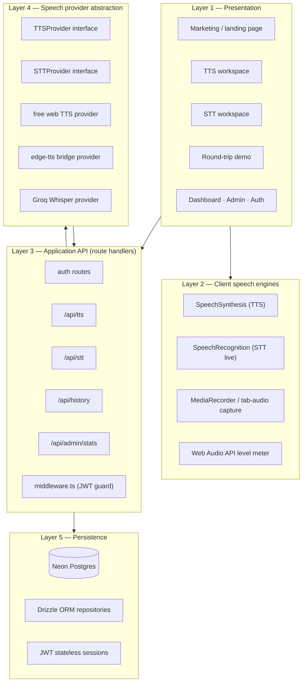
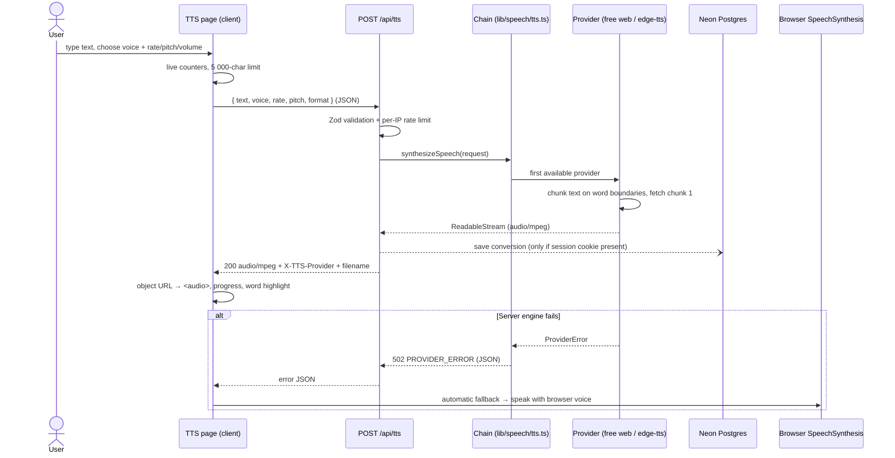
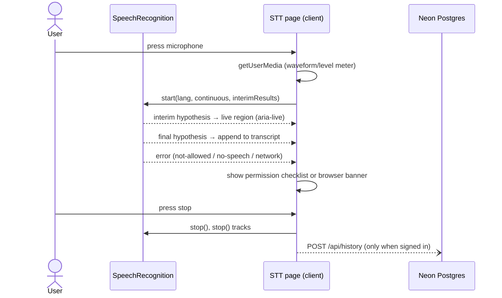
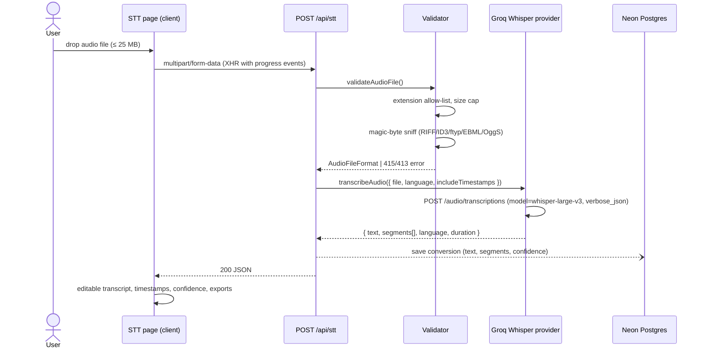
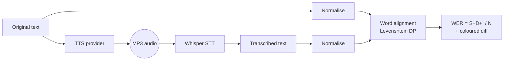
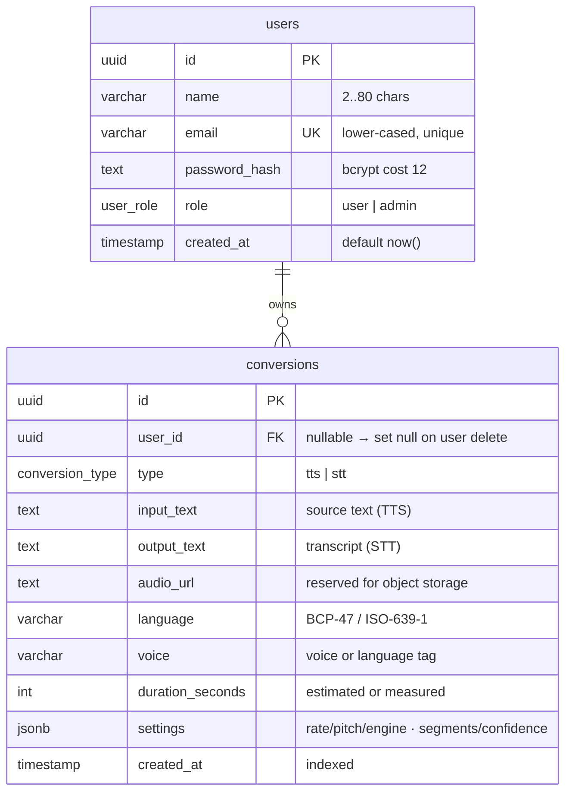
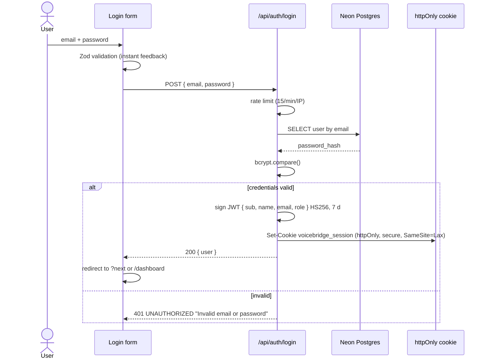
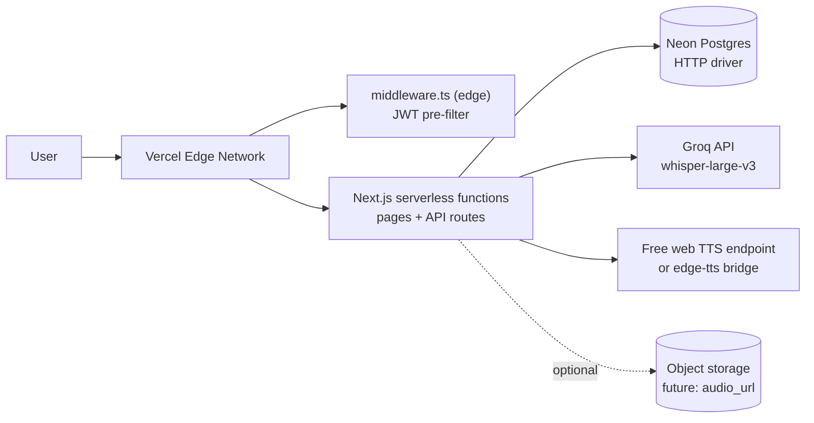

# VoiceBridge — System Design Document

> Companion document for the project **“Design and Implementation of a Text-to-Speech / Audio
> System and Vice-Versa.”** The sections below are written so they can be adapted directly into
> the design chapters of a project report.

---

## 1. System architecture

VoiceBridge follows a **layered client–server architecture** implemented entirely within a single
Next.js application. Each layer only depends on the layer directly beneath it, which is what makes
the speech engines replaceable without touching the interface.



### 1.1 Component responsibilities

| Component | Responsibility |
| --- | --- |
| Pages (App Router) | Layout, state, accessibility, optimistic UI, error/empty/loading states |
| `lib/speech` | Provider **interfaces** + orchestrators (`synthesizeSpeech`, `transcribeAudio`) that pick the first available engine and aggregate failures |
| Route handlers | Input validation (Zod), per-IP rate limiting, authentication, history persistence, typed JSON errors |
| `middleware.ts` | Cheap signature verification of the session cookie for `/dashboard` and `/admin` before rendering |
| `lib/db` | Lazy Drizzle/Neon client, schema, admin seed script |
| `lib/utils` | WER engine, validators, audio sniffing, formatters, download builders |

### 1.2 Why a pluggable provider layer

Both directions of the pipeline are expressed as small interfaces:

```ts
export interface TTSProvider {
  readonly id: string;
  readonly label: string;
  isAvailable(): Promise<boolean>;
  synthesize(request: TTSRequest): Promise<TTSResult>;
}

export interface STTProvider {
  readonly id: string;
  readonly label: string;
  isAvailable(): Promise<boolean>;
  transcribe(request: STTRequest): Promise<STTResult>;
}
```

The orchestrator walks an ordered chain (chosen by `TTS_PROVIDER` / `STT_PROVIDER`), records why
each engine was skipped or failed, and returns one aggregated, user-readable error only when the
whole chain fails. Adding a new engine is a single new file in `lib/speech/providers/`.

---

## 2. Data flow — Text-to-Speech pipeline



**Key decisions**

1. **Validation twice.** The client enforces limits for instant feedback; the server re-validates
   because it is the only trustworthy boundary.
2. **Stream, don’t buffer.** The provider fetches the first chunk before the response headers are
   written, then streams the remaining chunks — first audio arrives in ~1 RTT.
3. **Fail soft.** Provider errors become typed JSON (`PROVIDER_ERROR`, `PROVIDER_UNAVAILABLE`,
   `RATE_LIMITED`) and the UI degrades to the free browser engine rather than dead-ending.
4. **History is best effort.** `saveConversion()` never throws: guests and database outages must
   not break synthesis.

---

## 3. Data flow — Speech-to-Text pipeline

### 3.1 Live dictation (browser engine)



### 3.2 File transcription (server engine)



**Key decisions**

1. **Sniff, don’t trust.** The declared extension is compared with the file’s magic bytes, so a
   PNG renamed to `.mp3` is rejected locally with a human-readable message before any provider is
   called (and before any bytes leave the server).
2. **Verbose responses.** `verbose_json` yields segment timings (for `.srt` export), the ISO-639-1
   language, total duration and `avg_logprob`, which is converted to a confidence score with
   `exp(avg_logprob)` when the provider does not report one directly.
3. **Progress.** Upload progress is taken from `XMLHttpRequest.upload.onprogress`, which `fetch`
   cannot observe.

---

## 4. Round-trip accuracy analysis



Normalisation: Unicode NFKD → lower-case → strip punctuation (letters/numbers/apostrophes kept)
→ collapse whitespace. This is the standard convention for ASR benchmarking, so scores are
comparable with published WER figures. The alignment dynamic-programming table is back-tracked to
produce an operation list (`equal | substitute | delete | insert`) that powers both the diff UI and
the S/D/I counters.

---

## 5. Database design (ERD)



**Normalisation & indexing notes**

- The model is in **third normal form**: the only non-key attribute that depends on a JSON blob is
  intentionally flexible (`settings`), because TTS and STT need disjoint fields and a shared table
  keeps reporting queries simple.
- Composite-free foreign key `conversions.user_id` with `ON DELETE SET NULL` keeps historical
  records if an account is removed.
- Indexes: `users(email)` (login look-up), `conversions(user_id)`, `conversions(created_at)`
  (dashboard ordering), `conversions(type)` (filters and admin counts).
- **No `sessions` table**: sessions are stateless JWTs, so logout is a cookie deletion and there is
  nothing to garbage-collect.

---

## 6. Use cases

| ID | Actor | Goal | Type | Notes |
| --- | --- | --- | --- | --- |
| UC-01 | Guest | Convert written text into audible speech | Primary | Browser engine, no account |
| UC-02 | Guest | Generate a downloadable MP3 from text | Primary | Server provider chain |
| UC-03 | Guest | Control speed, pitch, volume and voice | Primary | 0.5×–2×, grouped voices |
| UC-04 | Guest | Follow the current word while audio plays | Primary | Boundary events or time estimate |
| UC-05 | Guest | Capture playback and download it | Secondary | `MediaRecorder` + tab audio; hidden if unsupported |
| UC-06 | Guest | Dictate speech into editable text | Primary | Live interim + final transcript |
| UC-07 | Guest | Upload an audio file for transcription | Primary | ≤ 25 MB, 5 formats |
| UC-08 | Guest | Export a transcript (txt/docx/srt) | Primary | Timestamps only when segments exist |
| UC-09 | Guest | Run text → audio → text and see a WER score | Primary | Show-case for project defence |
| UC-10 | User | Register / log in / log out | Primary | JWT httpOnly cookie |
| UC-11 | User | Review conversion history | Extension | Filter by type, re-open, re-download |
| UC-12 | User | Delete a stored conversion | Extension | Scoped to the owner by SQL predicate |
| UC-13 | User | View usage statistics | Extension | Totals, minutes, most-used language |
| UC-14 | Admin | View platform statistics and recent activity | Admin | `/admin` + `GET /api/admin/stats` |
| UC-15 | System | Reject oversized/invalid/rate-limited input | Automatic | Typed JSON errors |
| UC-16 | System | Fall back to the browser voice on provider failure | Automatic | Keeps the tool usable offline |
| UC-17 | System | Steer unsupported browsers to file transcription | Automatic | Feature-detection banner |

---

## 7. Speech technologies

### 7.1 Synthesis (text → speech)

Two complementary engines are implemented behind one interface:

| | Browser `SpeechSynthesis` | Server provider chain |
| --- | --- | --- |
| Cost | Free | Free web endpoint by default; `edge-tts` bridge optional |
| Privacy | Audio never leaves the device | Text is sent to the provider |
| Voices | Every voice installed on the OS/device (English US/UK/NG where available) | Language/accent tags (e.g. `en-NG`) |
| Output | In-memory playback | Streamable `audio/mpeg` download |
| Controls | rate, pitch, volume, boundary events | rate (affects duration estimate), language |
| Failure mode | n/a | Automatic fallback to the browser engine |

The browser path uses `SpeechSynthesisUtterance` events (`onstart`, `onboundary`, `onpause`,
`onend`, `onerror`). `onboundary` supplies the character index of the word being spoken, which
drives the highlight; when a browser omits boundary events (or during server playback) the UI
falls back to a time-proportional estimate derived from the word count and chosen rate. A small
keep-alive interval works around Chromium’s tendency to pause long utterances after ~15 s.

### 7.2 Recognition (speech → text, live)

Live dictation uses the Web Speech API (`SpeechRecognition` / `webkitSpeechRecognition`) in
**continuous** mode with **interim results** enabled:

- `onresult` yields partial hypotheses (rendered in an `aria-live` region) and final hypotheses
  (appended to the transcript, with `confidence` when provided).
- Chrome stops the recogniser after long silences, so the wrapper restarts it automatically while
  the user has not pressed stop.
- Error codes are mapped to actionable copy: `not-allowed`/`service-not-allowed` produces a
  numbered permission checklist, `audio-capture` reports a missing device, `network` points to the
  file-transcription path.
- Feature detection hides or disables the control where the API is absent (Firefox, Safari) and a
  banner steers users to `/stt?tab=file`.

### 7.3 Recognition (speech → text, files) — Whisper

Uploaded audio is transcribed server-side with **`whisper-large-v3`** served by the Groq API:

- `response_format=verbose_json` returns the transcript, segment timestamps, the detected ISO-639-1
  language and total duration.
- The request is a standard `multipart/form-data` POST with `Authorization: Bearer <GROQ_API_KEY>`;
  the key never reaches the browser.
- Segments drive the `.srt` exporter (`HH:MM:SS,mmm --> HH:MM:SS,mmm`) and the confidence chip
  (`segment.confidence` when present, otherwise `exp(avg_logprob)` averaged over segments).
- Whisper’s robustness to noise, accents and code-switching makes it the right choice for the
  file path, while the browser recogniser covers low-latency dictation.

### 7.4 Why both directions matter

Round-trip evaluation closes the loop: the same text is rendered to audio by the TTS engine and
read back by the ASR engine. Any mismatch — mispronunciation, acoustic colouring, homophone
confusion — shows up as substitutions, deletions or insertions in the WER score, giving an
objective, reproducible accuracy metric for the system as a whole.

---

## 8. Security design

| Threat | Counter-measure |
| --- | --- |
| Credential theft | bcrypt cost 12; hashes never leave the database |
| Session hijacking via XSS | JWT in `httpOnly` + `secure` + `SameSite=Lax` cookie — unreadable from JS |
| CSRF | SameSite=Lax cookie + JSON-only state-changing routes (no form posts) |
| SQL injection | Drizzle parameterised queries everywhere; no string concatenation |
| Malicious uploads | Extension allow-list, 25 MB cap, magic-byte sniffing, sanitised filenames |
| Brute force | Per-IP fixed-window rate limits on auth, TTS and STT routes |
| Privilege escalation | Role read from the *database* (not the token) for authorisation; middleware only pre-filters |
| Secret leakage | `GROQ_API_KEY`, `JWT_SECRET`, `TTS_API_URL` are server-only; no `NEXT_PUBLIC_` secrets |
| Clickjacking / MIME sniffing | `X-Frame-Options`, `X-Content-Type-Options: nosniff`, strict permissions policy |
| Oversized payloads | Body/file limits validated before provider calls; clear 413 responses |

---

## 9. Non-functional requirements

| Category | Requirement | How it is met |
| --- | --- | --- |
| Performance | Lighthouse ≥ 90 on the landing page | Static prerender, 103 kB shared JS, no blocking fonts, lazy client islands |
| Performance | Stream audio | Chunked provider streaming with `Content-Length` omitted (transfer encoding) |
| Reliability | Provider fallback | Chain + browser-voice fallback; typed JSON errors |
| Reliability | Database outage | Lazy client, `DATABASE_ERROR` 503 with a human message, dashboard banner, JWT fallback for `/api/auth/me` |
| Availability | Guests can always work | Every tool functions without an account; history is a bonus |
| Usability | Feedback everywhere | Spinners, skeletons, progress bars, toasts, empty states |
| Accessibility | Keyboard + AT support | ARIA labels, `role="tablist"`/`radiogroup`, live regions, focus-visible rings, skip link |
| Portability | Chromium, graceful elsewhere | Feature detection for SpeechRecognition and MediaRecorder |
| Maintainability | Strict TS, no `any` | `tsc --noEmit`, ESLint, small single-purpose modules |
| Testability | Pure logic isolated | WER and validators are dependency-free and unit-tested |

---

## 10. Sequence summary — authentication



---

## 11. Deployment topology



Everything deploys as a single Vercel project; no workers, queues or additional services are
required for the current scope.
